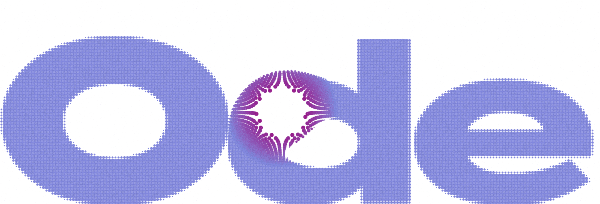
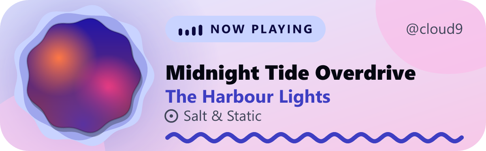

<p align="center">
  <picture>
    <source media="(prefers-color-scheme: dark)" srcset="docs/img/banner-dark.png">
    
  </picture>
</p>

<p align="center"><strong>A now-playing card for your GitHub profile that actually looks designed.</strong></p>

<p align="center">
  <a href="https://ode.cl0ud-9.workers.dev"></a>
  &nbsp;
  <a href="https://deploy.workers.cloudflare.com/?url=https://github.com/Cl0ud-9/Ode"></a>
</p>

<p align="center">
  <a href="https://github.com/Cl0ud-9/Ode/actions/workflows/ci.yml"></a>
  <a href="LICENSE"></a>
  
  
</p>

<p align="center">
  <a href="#get-your-own-card">Get your own card</a> &nbsp;·&nbsp;
  <a href="#options">Options</a> &nbsp;·&nbsp;
  <a href="#more-covers">More covers</a> &nbsp;·&nbsp;
  <a href="#troubleshooting">Troubleshooting</a> &nbsp;·&nbsp;
  <a href="#how-it-works">How it works</a> &nbsp;·&nbsp;
  <a href="docs/ARCHITECTURE.md">Architecture</a>
</p>

<br>

<p align="center">
  <picture>
    <source media="(prefers-color-scheme: dark)" srcset="docs/img/expressive-dark-playing.png">
    
  </picture>
</p>

Ode reads your listening from [Last.fm](https://www.last.fm), takes its colours from the album art, and draws an SVG you drop into your profile README. Anything that scrobbles to Last.fm works: Spotify, Apple Music, YouTube Music through a scrobbler, [LastWave](https://github.com/Clash-Projects/LastWave-native) and many more.

The [live demo](https://ode.cl0ud-9.workers.dev) is the author's own deployment, so it shows the author's listening. Add `?demo` to its address to see the sample card instead.

<br>

<p align="center">
  
  &nbsp;
  
</p>

<p align="center">
  
  &nbsp;
  
</p>

<p align="center"><sub>Three themes: <b>expressive</b> (the default, shown above and top row), <b>minimal</b> and <b>terminal</b>. Top row: a song that last played, and a track no source had a cover for.</sub></p>

<br>

## What you get

<table>
  <tr>
    <td width="50%" valign="top"><b>Colours from the cover</b><br>A Material-style tonal palette is built from each album, with contrast checked so text stays readable in light and dark.</td>
    <td width="50%" valign="top"><b>A cover for every song</b><br>If Last.fm has no artwork, Ode asks Genius, iTunes and MusicBrainz, and as a last resort reads the official cover off the artist's YouTube "Topic" upload. If none has it, the card draws a tonal placeholder, seeded from the artist and album so each one gets its own colours.</td>
  </tr>
  <tr>
    <td width="50%" valign="top"><b>A wave while you listen</b><br>The Material 3 Expressive wavy line spans the card and travels while a song plays. It is not a progress bar: Last.fm does not report where you are in a song. When nothing plays, there is no line at all.</td>
    <td width="50%" valign="top"><b>Motion that matches the music</b><br>Each song's Last.fm tags set the card's tempo: a slow, low wave for ambient or devotional music, a fast, tall one for EDM or metal.</td>
  </tr>
  <tr>
    <td width="50%" valign="top"><b>Material You colour styles</b><br><code>scheme=</code> picks Android's dynamic-colour variants: tonal spot, vibrant, expressive, fidelity or monochrome, or the cover's own colours (the default).</td>
    <td width="50%" valign="top"><b>Calm when nothing plays</b><br>It shows what you last listened to and how long ago. Empty and error states are designed too, and a day-old good card is served if Last.fm has a bad moment.</td>
  </tr>
  <tr>
    <td width="50%" valign="top"><b>Light, dark or follow the viewer</b><br>One image adapts to the reader's colour scheme.</td>
    <td width="50%" valign="top"><b>Gentle motion, never required</b><br>All motion honours reduced motion and can be switched off with <code>still=1</code>.</td>
  </tr>
  <tr>
    <td width="50%" valign="top"><b>No database, no always-on server</b><br>One Cloudflare Worker on the free plan, with your own keys.</td>
    <td width="50%" valign="top"><b>Yours alone</b><br>Ode is not a shared service. Each person runs their own copy, so your card is fast and private to you, and never competes with anyone else for limits.</td>
  </tr>
</table>

<br>

## Get your own card

Ode is not a shared service. Each person runs their own copy on a free Cloudflare account, so your card is fast, private to you, and never competes with anyone else for limits. It takes about five minutes and needs no command line.

### 1. Get a Last.fm API key

Create one at [last.fm/api/account/create](https://www.last.fm/api/account/create). The name and description can be anything. Copy the **API key**. Your Last.fm profile must be public: in your Last.fm privacy settings, leave "Hide recent listening information" unticked.

### 2. Deploy to Cloudflare

Press the **Deploy to Cloudflare** button above. Sign in (or create a free account), let it copy Ode into your GitHub account, and paste your API key when it asks for `LASTFM_API_KEY`. The optional keys below can be left empty for now.

Then tell your copy whose listening to show. In your copy of the repository, open `wrangler.toml` and set your Last.fm username:

```toml
[vars]
LASTFM_USER = "your-lastfm-name"
```

Commit the change and Cloudflare redeploys. Only the users named here get cards from your deployment: anyone else sees a card inviting them to deploy their own, so nobody can spend your keys or limits. (Set `OPEN_TO_ALL = "true"` under `[vars]` if you do want to serve any Last.fm user.)

<details>
<summary>Prefer a terminal?</summary>

<br>

Clone the repository, then:

```bash
npm install
npx wrangler login
npx wrangler secret put LASTFM_API_KEY   # paste your key
npm run deploy                           # prints your Worker's address
```

</details>

### 3. Open your Worker and copy the snippet

Your Worker's address looks like `https://ode.YOUR-SUBDOMAIN.workers.dev`. Open it: that is Ode's website, showing your live card. Scroll to **Yours in five minutes**, enter your Worker address and Last.fm name, pick a theme and colour style, and press **Copy snippet**.

### 4. Paste it into your profile README

Your profile README is the file `README.md` in a repository named exactly like your GitHub username. Paste the snippet there. It looks like this:

```html
<a href="https://www.last.fm/user/YOUR_LASTFM_NAME"></a>
```

Keep the `width` and `height` (use `height="87"` for the minimal theme): GitHub fetches a fresh card on every page load, and without a size the section collapses for the moment it takes to arrive. The outer link makes the card open your Last.fm profile; GitHub does not follow links inside an SVG, so the link has to wrap the image.

To follow GitHub's own theme instead of the viewer's system setting:

```markdown
<a href="https://www.last.fm/user/YOU">
<picture>
  <source media="(prefers-color-scheme: dark)" srcset="https://YOUR-WORKER.workers.dev/api/now?user=YOU&mode=dark">
  
</picture>
</a>
```

### 5. Check it

Open your profile, start a song, and reload. You can also test without playing anything: add `&demo=playing` to the card address (no user or key needed).

### Updating your copy

The button gives you a copy of Ode, not a link to this repository, so new versions do not arrive by themselves. To take one, add this repository as a second remote and merge it in:

```bash
git remote add upstream https://github.com/Cl0ud-9/Ode.git
git pull upstream main     # keep your own LASTFM_USER if wrangler.toml conflicts
git push                   # Cloudflare redeploys on its own
```

[CHANGELOG.md](CHANGELOG.md) says what changed in each version. To hear about new ones, use **Watch**, then **Custom**, then **Releases** on this repository.

## Options

| Parameter | Values | Default |
|---|---|---|
| `user` | Your Last.fm username (profile must be public) | required |
| `theme` | `expressive`, `minimal`, `terminal` | `expressive` |
| `mode` | `auto`, `light`, `dark` | `auto` |
| `scheme` | `content`, `tonal`, `vibrant`, `expressive`, `fidelity`, `mono` | `content` |
| `still` | `1` for no animation | off |
| `demo` | `playing`, `idle`, `noart`, `empty`, `error` (no key or user needed) | none |
| `fallback` | `artist`: use the artist's latest release when a track has no official cover (skips the fast path) | placeholder |

## More covers

Last.fm has the cover for most songs. For the rest, Ode asks more places, all at once, and uses the best answer. Two sources need nothing from you (iTunes and MusicBrainz with the Cover Art Archive). Two are free extras worth adding if some of your songs show a placeholder:

| Source | Set up | Notes |
|---|---|---|
| Genius | `npx wrangler secret put GENIUS_TOKEN` (free client access token from [genius.com/api-clients](https://genius.com/api-clients)) | Strong for songs Last.fm lacks, including many Indian and regional releases. Its limit belongs to your token, not to a shared IP. |
| YouTube | `npx wrangler secret put YOUTUBE_API_KEY` (free key, YouTube Data API v3) | Reads the label's official cover off the artist's auto-generated "Topic" upload. Works from anywhere. Only your own `LASTFM_USER` spends its daily quota. |
| iTunes | nothing | Apple throttles shared cloud IPs, so from Cloudflare it often answers "too many requests". It helps when it answers. |
| MusicBrainz | nothing | Official release art from the Cover Art Archive. Slower (a few seconds), and it asks callers to stay under about one request a second, so under load it is skipped for a minute rather than treated as "no cover". |

Every match is on the same artist and the same song, so a common name never borrows another song's cover. A song that no source has gets a generated placeholder, never a wrong cover.

<details>
<summary>See which songs are missing a cover</summary>

<br>

```bash
cp .dev.vars.example .dev.vars          # put LASTFM_API_KEY (and any optional keys) in it
npm run covers -- --user YOUR_LASTFM_NAME
```

This checks your most recent songs (add `--top` for your most played of the last three months, `--limit 60` for more) against the same sources a deployment uses, and prints which source found each cover, which songs Last.fm had no cover for but another source rescued, and which songs have none anywhere. To check one song without a key: `npm run covers -- --track "Artist | Title | Album"`.

To see where a live card's cover came from, look at the `X-Ode-State` header: `curl -sI "https://YOUR-WORKER/api/now?user=YOU"`.

</details>

## Troubleshooting

<details>
<summary>What you see, and what to do about it</summary>

<br>

| What you see | Why, and what to do |
|---|---|
| A "PRIVATE" card that says "Get your own card" | Your Last.fm name is not in `LASTFM_USER` for this Worker. Fix it in `wrangler.toml` and redeploy. Case does not matter, but the spelling must match. |
| "All quiet, No scrobbles yet" | Nothing has scrobbled yet, or your Last.fm profile hides recent listening. Open `https://www.last.fm/user/YOU` while signed out to see what the public sees. |
| The card does not change while the page is open | GitHub shows images as they were when the page loaded. Reload the page. Your Worker's own home page does update by itself. |
| A placeholder instead of the cover | No source had it. Run `npm run covers`, then add `GENIUS_TOKEN` and `YOUTUBE_API_KEY` (above). |
| An "OFFLINE" card ("Taking a breather") | Last.fm was busy or unreachable for a moment. The card refreshes on its own. If it stays, check that `LASTFM_API_KEY` is set. |
| Broken image on GitHub | Open the card address in a browser tab. If it loads there, check that the `` has no spaces in the address and that the snippet's `&` characters are not escaped twice. |
| It says "playing" when you stopped | Some players never clear Last.fm's "now playing" flag. After 20 minutes Ode shows the song as last played. |

</details>

## How it works

```
Last.fm  <- every 5 s --  presence object (current track, cover, palette, kept ready)
                                   |  one in-memory read
GitHub image proxy  ->  Worker /api/now  ->  SVG (fresh on every page load: max-age=0)
```

A presence object (a Cloudflare Durable Object, free plan) watches your Last.fm in the background. When the track changes it fetches the official cover straight away, so a card request never waits on Last.fm or a lookup: it is one read and a render. Users not in `LASTFM_USER` use the plain path (Last.fm on each request).

See [docs/ARCHITECTURE.md](docs/ARCHITECTURE.md) for the data model, caching and how to add another music source.

## Honest limits

<details>
<summary>What Ode cannot do, and why</summary>

<br>

- **On GitHub it updates on reload.** GitHub's image proxy used to keep each card for about a minute; Ode now sends `max-age=0`, which the proxy honours, so every reload shows the current song. The image itself cannot be swapped while the page stays open, though its animation keeps running.
- **"Now playing" depends on your player.** It appears only if the app tells Last.fm what is playing right now. Otherwise you see the last scrobble. If Last.fm briefly drops the flag mid-song, the track seen playing in the last 90 seconds is kept, so the card does not flip back to the previous song.
- **No progress bar.** Last.fm reports no playback position, so the wave simply spans the card while something plays rather than inventing progress.
- **How fast.** A new song is noticed within about 5 seconds of Last.fm hearing about it, and its cover is fetched at that moment, so a reload shortly after shows both. If a cover takes over 1.5 seconds, the song appears first and the cover a moment later.
- **Free-plan budget.** Polling every 5 seconds is about 17,000 Durable Object requests a day (the free plan allows 100,000). Polling slows after hours of silence and stops for users no longer in `LASTFM_USER`.
- **Fonts vary by device.** The card's text uses the reader's system fonts, which an SVG image cannot change. Titles are measured conservatively and shortened with an ellipsis rather than overflowing, and Latin, Indic, Arabic, CJK and emoji titles are all fitted.
- Verify SVG behaviour on GitHub itself: see [docs/VERIFY-ON-GITHUB.md](docs/VERIFY-ON-GITHUB.md).

</details>

## Development

```bash
npm install
npm run check      # typecheck + tests
npm run dev        # run locally (put LASTFM_API_KEY in .dev.vars)
npm run preview    # render every theme and state to ./preview (PNG + SVG)
npm run covers     # check which of your songs get a cover (see above)
```

The website is plain HTML, CSS and JavaScript in [site/](site), with no build step. See [CONTRIBUTING.md](CONTRIBUTING.md) before opening a pull request, and [SECURITY.md](SECURITY.md) to report a vulnerability.

## License

Ode is **source-available**: Copyright 2026 Cloud/9, all rights reserved. You can read the source, deploy your own copy for your own profile, and fork it to contribute back. Redistributing it, publishing modified or rebranded copies, running a public instance for other people, selling it, or using it to train AI models is not allowed without written permission. See [LICENSE](LICENSE) for the full terms.

Bundled libraries, fonts and the icon keep their own licenses, listed in [NOTICE](NOTICE).

<br>

<p align="center">
  <sub>Made by <a href="https://github.com/Cl0ud-9">Cloud/9</a>. If Ode makes your profile nicer, a star on the repository is a good way to say so.</sub>
  <br>
  <sub>Ode is an independent project. It is not affiliated with or endorsed by Last.fm or any music player. Last.fm is a trademark of its owner.</sub>
</p>
