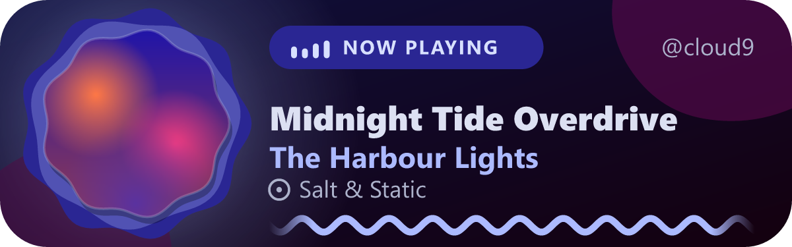
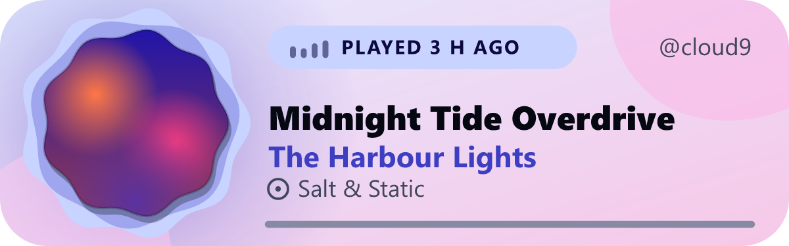
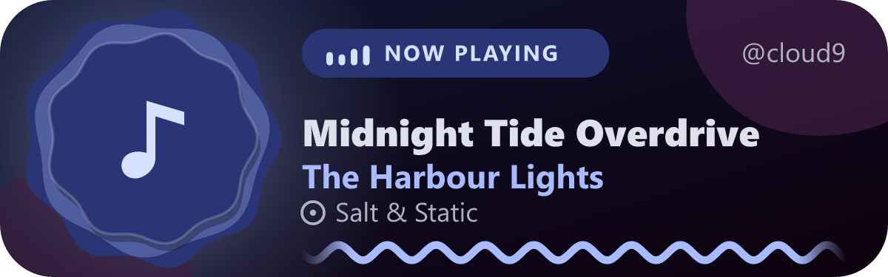
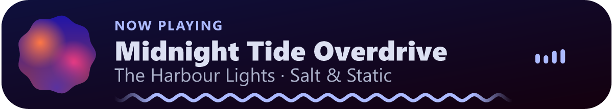
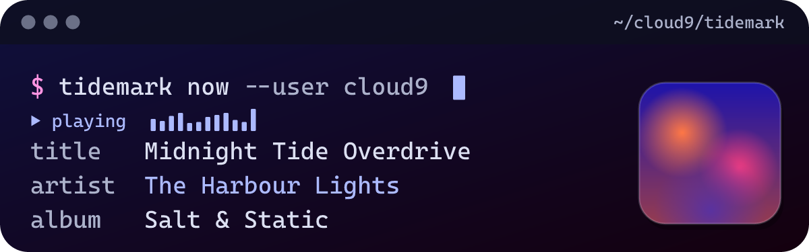

# Tidemark

A now-playing card for your GitHub profile that actually looks designed.

Tidemark reads your listening from [Last.fm](https://www.last.fm), pulls its colours from the album art, and draws an SVG you drop into your README. Anything that scrobbles to Last.fm works, including [LastWave](https://github.com/Clash-Projects/LastWave-native).



|  |  |
|---|---|
|  |  |
|  |  |

- **Colours from the cover.** A Material-style tonal palette is built from each album, with contrast checked so text stays readable in light and dark.
- **A cover for every song.** If Last.fm has no artwork, Tidemark looks the track up in the iTunes catalogue. If that finds nothing too, the card draws a tonal placeholder, seeded from the artist and album so each one gets its own colours.
- **Calm when nothing plays.** It shows what you last listened to and how long ago. Empty and error states are designed too, and a day-old good card is served if Last.fm has a bad moment.
- **Light, dark or follow the viewer.** One image adapts to the reader's colour scheme.
- **Gentle motion, never required.** Animation is CSS only, honours reduced motion, and can be switched off with `still=1`.
- **No database, no always-on server.** One Cloudflare Worker, edge cache, one secret.

## Use it in your README

Deploy your own copy (below). Each person runs their own, so there is no shared public instance. Then add:

```markdown
[](https://www.last.fm/user/YOUR_LASTFM_NAME)
```

The outer link makes the card open your Last.fm profile when clicked. GitHub does not follow links inside an SVG, so the link has to wrap the image in your markdown.

Open your Worker's home page for a live preview and a markdown generator that includes the link.

To follow GitHub's own theme instead of the viewer's system setting:

```markdown
<a href="https://www.last.fm/user/YOU">
<picture>
  <source media="(prefers-color-scheme: dark)" srcset="https://YOUR-WORKER.workers.dev/api/now?user=YOU&mode=dark">
  
</picture>
</a>
```

### Options

| Parameter | Values | Default |
|---|---|---|
| `user` | Your Last.fm username (profile must be public) | required |
| `theme` | `expressive`, `minimal`, `terminal` | `expressive` |
| `mode` | `auto`, `light`, `dark` | `auto` |
| `still` | `1` for no animation | off |
| `demo` | `playing`, `idle`, `noart`, `empty`, `error` (no key or user needed) | none |

## Deploy your own

You need a free [Cloudflare](https://dash.cloudflare.com/sign-up) account and a free [Last.fm API key](https://www.last.fm/api/account/create).

```bash
npm install
npx wrangler login
npx wrangler secret put LASTFM_API_KEY   # paste your key
npm run deploy
```

Local development: put `LASTFM_API_KEY=...` in `.dev.vars`, then `npm run dev`.

## How it works

```
Last.fm  ->  Worker (fetch, palette, SVG)  ->  edge cache  ->  GitHub image proxy  ->  README
```

See [docs/ARCHITECTURE.md](docs/ARCHITECTURE.md) for the data model, caching and how to add another music source.

## Honest limits

- **It is not live.** GitHub proxies and caches README images, so the card updates when the page is reloaded and the proxy has refreshed, typically within a minute or two, sometimes longer. It will never tick like a real player.
- **"Now playing" depends on your player.** It appears only if the app tells Last.fm what is playing right now. Otherwise you see the last scrobble. If a player never clears that flag, a track that has been "playing" for over 20 minutes is shown as last played instead. The 20 minutes are counted from the first time the card is requested while that track is playing, so a long gap between views can delay this.
- **No listening time.** Last.fm scrobbles carry no durations, so Tidemark does not claim minutes listened.
- **Only official artwork.** Covers come from Last.fm's own album data, then the iTunes catalogue (artwork supplied by labels and artists, matched on the same artist and the same title, fetched at 300px). Nothing community-uploaded is used. If a track is in neither (edits, mashups, YouTube uploads where the "artist" is a channel name), the card draws a generated placeholder rather than a wrong cover. `&fallback=artist` opts in to the artist's latest release instead.
- **Instant covers need the warm-up.** Apple throttles shared cloud IPs, so a lookup made while a card renders can fail or be slow. A per-minute cron job (`[triggers]` in `wrangler.toml`, with `LASTFM_USER` set to your username) looks up the current track's cover and keeps it in KV for 7 days, so the card only reads Last.fm plus a cache hit. A brand-new track can show the placeholder for up to a minute. A lookup that runs over 2.5 seconds is finished in the background.
- **Why KV.** Cloudflare's Cache API does nothing on `workers.dev` domains, so covers and the stuck-"playing" guard are kept in a KV namespace (`ART`), which `wrangler deploy` creates for you.
- **Fonts vary by device.** The text uses the reader's system fonts, which an SVG image cannot change. Text is measured conservatively and shortened with an ellipsis rather than overflowing.
- Verify SVG behaviour on GitHub itself: see [docs/VERIFY-ON-GITHUB.md](docs/VERIFY-ON-GITHUB.md).

## Development

```bash
npm run check      # typecheck + tests
npm run preview    # render every theme and state to ./preview (PNG + SVG)
```

Tidemark is an independent project. It is not affiliated with or endorsed by Last.fm or any music player. Last.fm is a trademark of its owner.

## License

Tidemark is **source-available**: Copyright 2026 Cloud/9, all rights reserved. You can read the source, deploy your own copy for your own profile, and fork it to contribute back. Redistributing it, publishing modified or rebranded copies, running a public instance for other people, selling it, or using it to train AI models is not allowed without written permission. See [LICENSE](LICENSE) for the full terms and [CONTRIBUTING.md](CONTRIBUTING.md) to help out.

Bundled libraries keep their own licenses, listed in [NOTICE](NOTICE).
